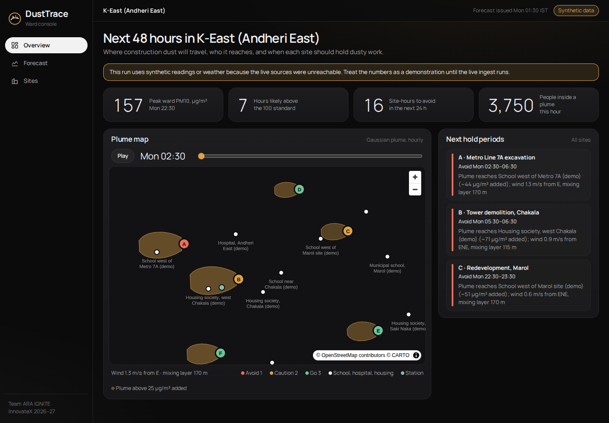
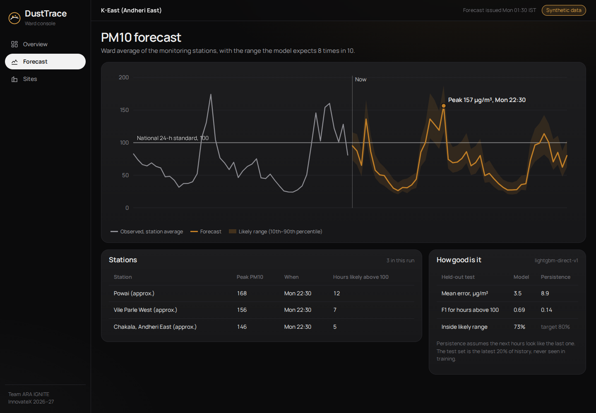
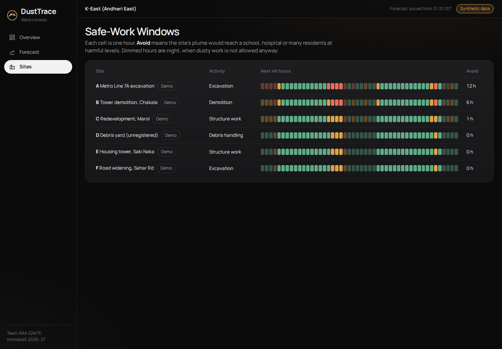
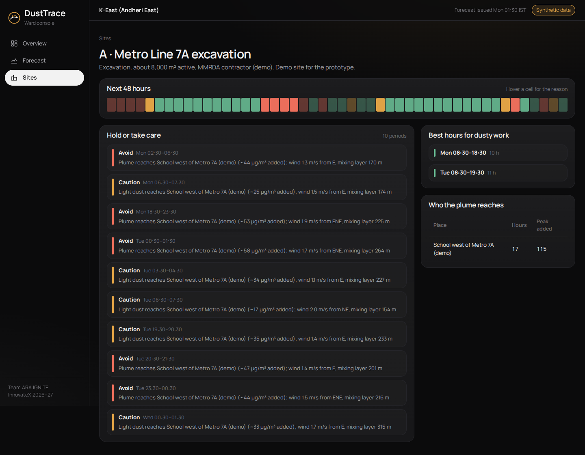

# DustTrace

Live console: https://dusttrace-mumbai.vercel.app (password from the team). Public site pages: `/s/A` … `/s/F`.

Forecast, prevent and prove construction dust in Mumbai wards. Built by Team ARA IGNITE (Ansh, Dhruv, Anuj, Sarang) for Techfest IIT Bombay InnovateX 2026–27, Theme 2: Rising AQI.

DustTrace forecasts PM10 48 hours ahead, models where each construction site's dust plume will drift, and gives every site **Safe-Work Windows**: the hours when dusty work would reach a school, hospital or many residents, and the hours when it is safe to go ahead.



## What's here

| Path | What |
|---|---|
| `services/engine` | Python: ingest (Open-Meteo, OpenAQ, OpenStreetMap), LightGBM forecast, Gaussian plume, Safe-Work Windows |
| `apps/web` | Next.js ward console: plume map, forecast, site windows |
| `supabase/migrations` | Postgres + PostGIS schema |
| `docs/` | PRD, pitch deck, prototype, video kit, design system |
| `HANDOFF.md` | Project status and next steps |

## Quick start

```bash
export DATABASE_URL=postgresql://postgres@localhost:5432/dusttrace   # Postgres 16 + PostGIS
cd services/engine && pip install -e ".[dev]" && python -m dusttrace all
cd ../../apps/web && npm install && npm run dev
```

If the live APIs are unreachable, the engine falls back to synthetic data and the console labels the run as synthetic. See `HANDOFF.md` for details.

## Screens

| Forecast | Sites | Site detail |
|---|---|---|
|  |  |  |
