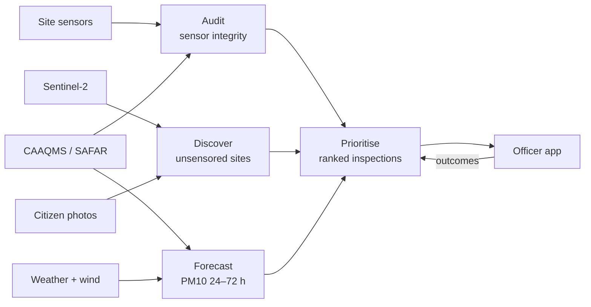
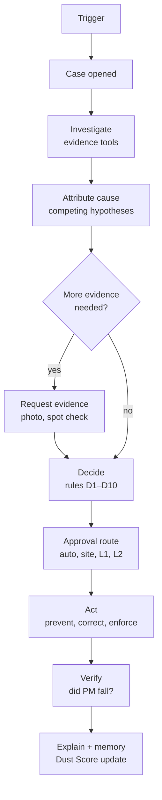
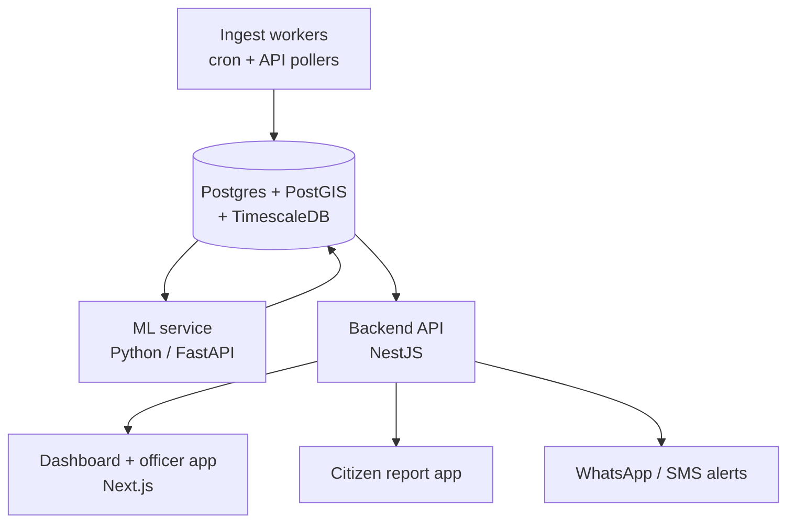
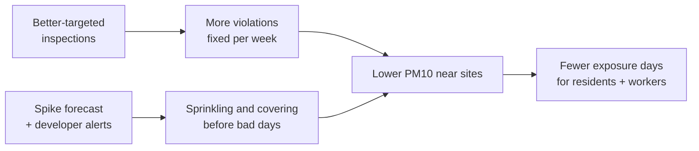

# DustTrace — PRD

Techfest InnovateX 2026–27 · Theme 2: Rising AQI · Sep 24, 2026 · @Teak

## Overview

DustTrace forecasts construction-dust PM10 spikes in Mumbai 24–72 hours ahead and tells enforcement officers which specific sites to inspect before the spike happens. It starts with no new hardware, adding low-cost DustTrace Nodes only where no sensor exists. It is an analytics, prevention and enforcement layer over two IoT networks Mumbai already runs (CAAQMS ambient stations and BMC's mandated construction-site sensors), plus satellite imagery and citizen reports.

**One-line pitch:** We stop construction dust before it reaches people: forecast spikes 48 h ahead, move dusty work to safer hours, and point BMC at the sites to inspect, using sensors Mumbai already mandates.

**Competition fit (Theme 2 — Rising AQI):**

| Brief asks for | DustTrace answer |
| --- | --- |
| Specific pollution source | Construction and demolition (C&D) dust |
| Monitor | BMC construction-site sensor feed, CPCB/MPCB CAAQMS + SAFAR stations, Sentinel-2 site detection, citizen photo reports |
| Predict | Ward-level PM10 spike forecast, 24–72 h horizon (AI-driven forecasting) |
| Reduce | Ranked, wind-aware inspection list and pre-emptive alerts to ward officers and developers |
| Technology from the brief's list | AI-driven air quality forecasting (core), IoT sensors (existing network; low-cost nodes in Phase 2), urban planning (permit-density insights) |
| Integration with city systems | Exports to BMC ward-office workflows; API for MPCB |

**Differentiator:** most AQI projects stop at a dashboard or forecast. DustTrace closes the loop from *prediction* to *attribution* to *action*.

## Problem statement

Mumbai now has hundreds of IoT dust sensors at construction sites, but it cannot trust them, cannot see the sites without them, and cannot act before a spike. The enforcement gap is analytics, not hardware.

**Construction dust is Mumbai's leading air pollution source**, per BMC's Mumbai Air Pollution Mitigation Plan ([Karmactive](https://www.karmactive.com/bmc-air-quality-sensor-ultimatum-construction-sites-compliance-deadline/)). The regulatory response so far:

| Date | Step |
| --- | --- |
| Nov 2025 | 62 stop-work notices; a 95-ward inspection finds 117 sensors inactive and 44% developer compliance ([FPJ](https://www.freepressjournal.in/mumbai/mumbai-news-bmc-issues-stop-work-notices-to-62-construction-sites-for-air-pollution-violations-launches-citywide-dust-mitigation-drive)) |
| Oct 2025 | Only 535 of \~1,200 active sites (45%) have sensors; BMC issues a 30-day ultimatum ([Karmactive](https://www.karmactive.com/bmc-air-quality-sensor-ultimatum-construction-sites-compliance-deadline/)) |
| Jun 2025 | Sensor-based PM2.5/PM10 monitors + LED displays mandatory at all active sites, feeding BMC's Command & Control Centre |
| May 2025 | BMC shortlists 15 approved sensor models (circular MGC/F/6526) |
| Jan 2025 | Bombay High Court (SMPIL 3/2023) orders site-level monitoring to replace blanket ward-level construction bans |
| Oct 2023 | BMC issues air pollution mitigation guidelines for construction sites ([MCGM](https://www.mcgm.gov.in/irj/go/km/docs/documents/Environment/Resources/Guidelines%20for%20Air%20Pollution%20Mitigation%20%20-%20MGC-F-1102%20DTD.25.10.2023.pdf)) |

**The specific pain points DustTrace targets:**

1. **Untrustworthy data.** Sensors are low-cost optical units owned and placed by the developer being monitored. Of 662 installed, only 400 were linked to the city dashboard, and many were non-functional ([FPJ](https://www.freepressjournal.in/mumbai/mumbai-news-bmc-issues-stop-work-notices-to-62-construction-sites-for-air-pollution-violations-launches-citywide-dust-mitigation-drive)). Nobody systematically checks for flatlined, switched-off, badly placed or humidity-biased readings.
2. **Blind spots.** Roughly half of active sites had no sensor in late 2025, and unregistered sites (small redevelopment, demolition, debris dumping) never will.
3. **Reactive enforcement.** Inspections follow bad-AQI days. Squads are limited, so they need a ranked list of where to go, ideally a day before the spike.
4. **Attribution.** A bad ambient reading at a CAAQMS station does not say which of the dozens of upwind sites caused it.

**Open question:** current (Sep 2026) sensor count and compliance rate. The figures above are late-2025; confirm with BMC's Environment Department or the public dashboard before the zonal pitch.

## Existing solutions and gaps

Every existing tool either measures or restricts; none cross-checks the data, fills the blind spots, or tells an inspector where to go tomorrow.

| Existing approach | What it does | Where it falls short |
| --- | --- | --- |
| CAAQMS / SAFAR ambient stations | Area-scale AQI, city-level forecasts | \~km resolution; cannot attribute a spike to a site |
| BMC site sensors + Command & Control Centre | Real-time PM at each registered site, threshold alerts | Self-placed, self-maintained by the developer; no integrity checks; misses unregistered and non-compliant sites |
| Vendor compliance devices (e.g. [Oizom AQBot PM](https://www.prnewswire.com/ae/news-releases/oizoms-aqbot-pm-makes-bmcs-air-quality-mandate-easy-for-construction-sites-302581978.html)) | Help a single developer meet the mandate | Built for the site, not the regulator; no cross-site view |
| Ward-level construction bans | Halt all work in a bad-AQI ward | Punishes compliant sites; the High Court moved away from this in Jan 2025 |
| Physical inspections and complaints | Ground truth | Reactive, manual, limited squads, no prioritisation |

**DustTrace's gap:** a regulator-side intelligence layer that (a) audits the site-sensor feed against independent data, (b) estimates dust from sites with no sensor, (c) forecasts spikes, and (d) ranks inspections.

## Goals, non-goals and success metrics

The pilot succeeds if inspections guided by DustTrace find violations at least twice as often as today's inspections, and forecasts beat a persistence baseline.

**Goals**

1. Flag faulty or tampered site sensors automatically (sensor integrity score per site, daily).
2. Detect active construction sites with no sensor, from satellite imagery and citizen reports.
3. Forecast ward-level PM10 exceedance 24–72 h ahead.
4. Produce a daily ranked inspection list per ward with a reason for each site.
5. Close the loop: record inspection outcomes and feed them back into the models.

**Non-goals**

- Compliance-grade hardware. DustTrace reads existing site sensors and adds only low-cost DustTrace Nodes where no sensor exists.
- Issuing penalties. DustTrace recommends; BMC/MPCB officers decide.
- Non-construction sources (vehicles, bakeries, RMC plants) in v1. They appear only as confounders in the attribution model.
- A public AQI app. Citizens get a reporting flow, not another AQI viewer.

**Success metrics**

| Metric | Target (pilot) | How measured |
| --- | --- | --- |
| Inspection hit rate (violations found ÷ inspections) | ≥ 2× the ward's current rate | Inspection outcome logs |
| Faulty-sensor detection precision | ≥ 80% | Field verification of flagged sensors |
| Unregistered active site detection recall | ≥ 70% | Ward-office site survey of pilot wards |
| 24 h PM10 exceedance forecast | F1 ≥ 0.7, beats persistence baseline | Back-test on 2024–2026 station data |
| Time from citizen report to officer triage | < 24 h | App logs |
| PM10 at pilot-ward stations on high-risk days | −10% vs matched control wards | Difference-in-differences, one winter |

Pilot targets are team assumptions to validate, not published benchmarks.

## Users and user stories

The primary user is the BMC ward officer who has to decide which sites to inspect today; everyone else feeds or consumes that decision.

| Persona | Role | Needs | Primary surface |
| --- | --- | --- | --- |
| Ward environment officer | Plans daily inspections in one BMC administrative ward | Short, ranked list with reasons; mobile-friendly; record outcome in 1 minute | Officer mobile web app |
| Command & Control Centre analyst | Watches city-wide feeds | Which sensors to distrust, which wards will spike tomorrow | City dashboard |
| MPCB / BMC Environment Dept head | Policy and court reporting | Weekly compliance and impact reports, evidence for the High Court | Reports + API |
| Developer / site manager | Runs a construction site | Early warning that their site is at risk; proof of good behaviour | Site portal + SMS/WhatsApp alert |
| Resident | Lives near a site | Report visible dust in under a minute, see that it was acted on | Citizen reporting web app |

**User stories**

- As a **ward officer**, I open the app at 9 am and see the 5 sites most likely violating today, each with a reason ("sensor flatlined 3 days", "upwind of tomorrow's forecast spike", "3 citizen photos, no sensor"), so I can plan my route.
- As a **ward officer**, I mark an inspection as violation / compliant / site inactive with a photo, so the model learns.
- As a **C&C analyst**, I see every site sensor with an integrity score and the reason it is low, so I stop trusting broken feeds.
- As an **Environment Dept head**, I download a weekly ward report showing inspections, violations and PM10 trend, so I can report progress to the High Court.
- As a **developer**, I get a WhatsApp alert the evening before a predicted high-risk day, so I can scale up sprinkling and covering.
- As a **resident**, I photograph an uncovered debris pile, and the app geotags it and tells me when an officer has reviewed it.

## Solution and features

DustTrace runs four engines (Audit, Discover, Forecast, Prioritise) that turn raw feeds into one daily inspection list, plus a feedback loop from inspection outcomes.



Solid inputs on the left are all existing data; the only new data DustTrace creates is inspection outcomes and citizen reports.

### F1. Audit: sensor integrity scoring (P0)

Each site sensor gets a daily 0–100 integrity score from these checks:

| Check | Signal of a problem |
| --- | --- |
| Flatline / dropout | Constant or missing values for > 2 h during working hours |
| Neighbour consistency | Reads far below nearby sensors and the nearest CAAQMS station on the same wind |
| Working-hours signature | No PM rise during 9 am–6 pm on days the site is active in imagery |
| Humidity bias | Optical sensors over-read at high RH; readings not corrected or implausible vs RH |
| Placement | Sensor consistently cleaner than the ambient station even when it is downwind of the site |
| Calibration lapse | Drift over time vs co-located reference; overdue 2-monthly calibration |

### F2. Discover: sites with no sensor (P0)

- **Satellite change detection:** Sentinel-2 (10 m, \~5-day revisit) bare-soil and built-up change indices flag new excavation and demolition. Candidates are matched against the registered-site list; unmatched ones become "unsensored sites".
- **Citizen reports:** geotagged photo, a vision model classifies it (uncovered debris, no barricade, dry excavation, uncovered truck), and nearby reports are clustered into one site.

### F3. Forecast: PM10 exceedance (P0)

Predicts, for each ward and each station, the probability that 24 h PM10 exceeds the national standard (100 µg/m³) in the next 24, 48 and 72 h. Inputs: station history, weather forecast (wind speed, direction, boundary-layer height, RH, rain), day of week, festival calendar and active-site density upwind.

### F4. Attribute and prioritise (P0)

For each station and forecast hour, trace wind back-trajectories and score the sites upwind. The daily list ranks sites by:

```latex
\text{priority}_s = w_1 \cdot \text{upwind exposure}_s + w_2 \cdot (1 - \text{integrity}_s) + w_3 \cdot \text{citizen reports}_s + w_4 \cdot \text{unsensored}_s + w_5 \cdot \text{past violations}_s
```

Weights start hand-tuned and are learned from inspection outcomes once enough are logged. Every site in the list shows its top two reasons.

### F5. Alerts and reporting (P1)

- Evening WhatsApp/SMS alert to developers upwind of a forecast spike.
- Weekly ward report (PDF) for the Environment Dept and court filings.
- Public API for MPCB and researchers.

### F6. Officer app (P0)

Mobile web app: map + ranked list, route order, one-tap outcome logging with photo, offline-tolerant.

### F7. Prevent: Safe-Work Windows and forecast-triggered misting (P0, unique)

DustTrace's core differentiator is prevention: it changes what each site does before a spike instead of only finding violators afterwards. The solution is framed as three layers: **Predict** (forecast + exposure map), **Prevent** (this feature) and **Prove** (Audit, Discover, ranking, Dust Score).

- **Safe-Work Windows:** for every site and every hour of the next 48 h, output Go / Caution / Avoid for high-dust tasks (demolition, excavation, cutting, debris loading).
- **Inputs:** Open-Meteo wind, boundary-layer (mixing) height and rain forecasts; who is downwind (OpenStreetMap schools and hospitals, ward population); ambient PM forecast. Dispersion via a Gaussian plume approximation.
- **Forecast-triggered misting:** where a site's approved monitor has relay outputs (e.g. Oizom AQBot), DustTrace triggers sprinklers or mist cannons about 90 minutes before a predicted risky window, instead of after a threshold is crossed. Sites without relays get the instruction on WhatsApp.
- **Metric:** person-exposure avoided (people downwind × concentration × hours), target −20% in the pilot. This is a team assumption to validate.

### F8. Prove: public Dust Score on the site LED board (P1, unique)

- A 0–100 score per site, shown next to the PM readings on the LED board every site must already display, plus a public map.
- Proposed weights: sensor trust 30%, spikes traced to the site 25%, Safe-Work Windows followed 20%, verified citizen reports 15%, inspection history 10%.
- A QR code on the board opens a citizen report pre-tagged with the site ID.
- Proposed incentives, to be designed with BMC: 80+ earns fewer routine inspections; below 40 goes to the top of the inspection list.

### F9. Monitor: DustTrace Nodes where no sensor exists (P0)

Low-cost sensors of our own for places the BMC site-sensor network never reaches: housing societies next to sites, schools and hospitals downwind, debris dumps and unregistered work, and gaps between CPCB stations.

| Component | Approx. cost (team estimate) |
| --- | --- |
| ESP32 Wi-Fi board | ₹450 |
| PMS5003 laser dust sensor | ₹1,400 |
| Temperature + humidity sensor | ₹350 |
| Enclosure, power, mount | ₹500 |
| **Per node** | **≈ ₹2,700** (vs ₹1–2 lakh for a BMC-approved site monitor) |

- **What they add:** real exposure where people live; before/after proof that a Safe-Work Window cut dust at a school; an independent neighbour to check every developer sensor against; dust from sites with no sensor.
- **Calibration:** each batch is co-located with a CPCB station for 1–2 weeks, with humidity correction.
- **Role:** exposure and screening only. BMC-approved site monitors stay the compliance record.
- **Hosting:** the housing society or school provides power and Wi-Fi. Mobile nodes: the same node with GPS rides on BEST buses (2,792 buses, 1,324 electric, per ThePrint 2026), giving readings at sites with no sensor and a gate-side check on each site's own sensor. Only readings taken near a site count, compared with the same road stretch on other days, because on-road traffic dominates raw bus readings. Smog towers or roof filters on buses are out: Delhi's towers were reported ineffective to the NGT, and a UK bus-filter trial removed 65 g of particulates in 100 days.

### F10. Prevent at the cause: detect, fix, capture and clean (P0, unique)

DustTrace identifies the likely cause of dust at each site and sends a specific fix, following BMC's 28-point guidelines.

| Cause | How DustTrace detects it | Fix sent to the site |
| --- | --- | --- |
| Dry excavation, demolition | Work-hour spike of coarse dust (PM10 rises far more than PM2.5) | Spray water; move to Safe-Work Window |
| Truck track-out | Spikes at the gate at truck times; QR photos | Wheel wash, covered loads, gate sweeping |
| Uncovered debris | Satellite bare soil + photo classifier | Cover with green net within 2 hours |
| Dry, windy day ahead | Weather forecast: wind, no rain | Pre-wet the site; pause dusty tasks |

**Capture and clean, not just divert:**

- **Mist curtain:** fine-droplet misting along the site boundary, switched on by the forecast, captures dust before it leaves the site.
- **Green screens:** vegetation barriers on hoardings trap coarse dust. These are already part of BMC's dust SOP (Hindustan Times, 29 Mar 2023).
- **Clean air indoors:** when a school or hospital is downwind during an Avoid window, it is alerted to close windows and run classroom air purifiers.

### F11. Ward control-room dashboard with actionable alerts (P0)

One screen per ward, mirrored to site managers on WhatsApp. Every alert carries an action, not just a reading.

- **Live alerts:** Critical (spike with no mitigation running; mist triggered remotely), Action (dusty work inside an Avoid window; manager alerted), Sensor (flatlined or untrusted sensor; added to inspection list), Node (PM rising at a school; school told to close windows).
- **Map:** sites coloured by status, wind direction, forecast dust plume, DustTrace Nodes, schools and hospitals.
- **KPIs:** spike risk tomorrow, sites in an Avoid window, untrusted sensors, open citizen reports.
- **Inspect today:** the ranked list with reasons.

### F12. Dust Response Agent: the actions and prevention model (P0)

Every trigger opens a case. An agent investigates it, attributes a likely cause, picks actions under written dust rules D1–D10 with an approval route for each, then checks whether the air actually improved. The design follows our [hhgoa-fraud-agent](https://github.com/Ansh-Sonkusare/hhgoa-fraud-agent) (TigerGraph Hacker House Goa), with fraud swapped for dust and one new step: verification.

**Reference mapping**

| hhgoa-fraud-agent | DustTrace Dust Response Agent |
| --- | --- |
| Trigger: risk score, customer report, analyst | Trigger: forecast spike, live site exceedance, node reading at a school or hospital, QR report, satellite find, sensor-audit failure, officer request |
| Transaction graph in TigerGraph (graph DB needed for multi-hop fraud rings) | Site graph: sites, developers, site sensors, DustTrace Nodes, CPCB stations, receptors (schools, hospitals, societies), wards, cases, actions |
| GSQL evidence queries via MCP | Evidence tools: station series, site sensor series, node series, wind back-trajectory, Sentinel-2 change, QR photos, permits, prior cases at the site and developer |
| Competing fraud-pattern hypotheses with probabilities | Competing cause hypotheses with probabilities: dry excavation, demolition, truck track-out, uncovered debris, sensor fault, non-construction source, weather only |
| Fraud policy rules R1–R10 | Dust rules D1–D10, derived from BMC's 28-point guidelines |
| Approval routes auto / L1 / L2 | auto / site manager / L1 ward environment officer / L2 Assistant Commissioner |
| Evidence requests; no reply is invented | Site photo request, officer spot check, node redeploy; no reply is invented |
| `next_best_actions.initial`, `.final`, `what_changed` | Same structure |
| SAR when policy requires it | Inspection record and notice when D8 or D9 require it |
| Case written back to the graph as memory | Case and the measured result of each action written back; feeds the Dust Score and a "which fix works" memory |
| Leak-free backtest with `as_of` | Replay past winter days with `as_of`; no later readings visible |
| — | **New: Verify.** After acting, compare node and sensor readings before and after; a fix that did not lower PM keeps the case open |

**Storage: no separate graph database needed.** Most DustTrace questions are spatial or time-series (which sites are upwind of this school at 08:00, what is within 1 km, what did the sensor read in the last 3 h), so the "site graph" lives as tables in our existing Postgres: PostGIS for geometry and distance, TimescaleDB for sensor and node series, pgvector for similar-case search, and plain joins for developer → sites → cases links (2–3 hops over about 1,200 sites). Apache AGE (Cypher inside Postgres) or Neo4j are optional, only if we want graph algorithms or a network view for the finals demo.

**AI/ML models and where their data lives.** Models train on feature tables exported from Postgres (to Parquet, then Python), so the ML does not need a graph database either.

| Model | Job | Trained on | Data lives in |
| --- | --- | --- | --- |
| Spike forecast (LightGBM) | P(PM10 > 100) per ward and hour | Station series + weather feature table | TimescaleDB → Parquet → Python |
| Sensor Audit (rules + Isolation Forest) | Trust score per sensor | Residuals vs neighbours, station and DustTrace Nodes | TimescaleDB |
| Cause attribution | Competing cause probabilities | Spike shape (PM10/PM2.5 ratio, timing), wind, site activity, past inspection outcomes | Postgres feature table |
| Satellite discovery (U-Net or random forest) | Finds active sites | Sentinel-2 image patches | Raster files; results in PostGIS |
| Photo classifier (YOLOv8 / EfficientNet) | Labels QR report photos | Labelled site photos | Object storage |
| Agent (LLM) | Explains cases; weighs cause hypotheses alongside the cause model | Tool outputs, rules D1–D10, similar past cases | Tools = SQL/PostGIS queries; case memory = pgvector |
| Fix-effectiveness model | Which fix lowers PM for which cause | Before/after node readings per action | Postgres |

The agent mirrors the fraud agent: it calls tools (SQL/PostGIS queries instead of GSQL over MCP), retrieves similar past cases by vector search (pgvector instead of TigerGraph vectors), and the rules engine picks the actions. That is RAG over Postgres.

A graph only pays off for graph ML, such as a graph neural network over developer → sites → contractors → trucks to catch repeat offenders moving between sites. Even then the graph is built in Python (PyTorch Geometric or NetworkX) from Postgres tables. Neo4j stays an optional add-on for graph RAG or a network visual at the finals.

**Case flow**



States: TRIGGERED → CASE\_OPENED → INVESTIGATING → ATTRIBUTING → EVIDENCE\_PLANNING → AWAITING\_EVIDENCE → DECIDING → APPROVAL\_ROUTING → ACTING → VERIFYING → EXPLAINING → MEMORY\_UPDATE → DONE.

**Action catalog**

| Action | Type | Route | Rule |
| --- | --- | --- | --- |
| ISSUE\_SAFE\_WORK\_WINDOW | Preventive | auto | D2 |
| SCHEDULE\_MIST | Preventive | auto via relay, else site | D2 |
| PRE\_WET\_SITE | Preventive | site | D2 |
| ALERT\_RECEPTOR | Preventive | auto | D3 |
| NOTIFY\_RESIDENTS | Preventive | auto | D3 |
| TRIGGER\_MIST\_NOW | Corrective | auto via relay, else site | D4 |
| PAUSE\_DUSTY\_TASK | Corrective | site | D4 |
| ORDER\_COVER\_DEBRIS | Corrective | site, 2 h deadline | F10 playbook |
| ORDER\_WHEEL\_WASH | Corrective | site | F10 playbook |
| REQUEST\_SITE\_PHOTO | Evidence | site | D1 |
| FLAG\_SENSOR\_FOR\_AUDIT | Enforcement | auto | D5 |
| ADD\_TO\_INSPECTION | Enforcement | L1 | D5, D6, D7 |
| REGISTER\_UNSENSORED\_SITE | Enforcement | L1 | D6 |
| ISSUE\_NOTICE | Enforcement | L1 | D8 |
| RECOMMEND\_STOP\_WORK | Enforcement | L2 | D9 |
| REFER\_NON\_CONSTRUCTION | Routing | L1 | D10 |
| UPDATE\_DUST\_SCORE | Record | auto | every case |
| CLOSE\_NO\_ACTION | Close | auto | D10, or verified drop |

**Dust rules D1–D10** (proposed; thresholds to be agreed with BMC)

| Rule | When | Then |
| --- | --- | --- |
| D1 | A cause rests on one signal only | No enforcement. Request a site photo or officer spot check first |
| D2 | Forecast P(PM10 > 100 µg/m³) ≥ 0.60 for a ward and hour | Safe-Work Windows to every site whose plume reaches a receptor within 1 km; misting scheduled 90 min before |
| D3 | A school or hospital is downwind during an Avoid window | Alert the receptor (windows shut, purifiers on); notify nearby residents |
| D4 | Site sensor PM10 > 2× ambient for 15 min in working hours, mist off | Trigger mist now (relay) or notify the manager; pause dusty task if it continues |
| D5 | Sensor trust < 40/100 | Flag for audit and add to inspection; its readings cannot clear the site |
| D6 | Active site found with no sensor (satellite plus photo or node) | Register the site and add to inspection |
| D7 | A requested fix or photo is not confirmed by its deadline | Escalate to inspection; no reply is assumed |
| D8 | 3+ attributed exceedances in 7 days, or 2 ignored Safe-Work Windows | Issue a notice (L1) |
| D9 | Officer-confirmed violation, plus D8, plus receptor exposure | Recommend stop-work (L2). Never automatic |
| D10 | Non-construction cause most likely (RMC plant, bakery, burning, traffic) | No site action; refer to MPCB or the right BMC department with the evidence |

**Example case file (illustrative)**

```json
{
  "case_id": "DT-KE-0142",
  "trigger": { "type": "forecast_spike", "as_of": "2026-11-12T18:00+05:30",
               "detail": "P(PM10 > 100, K-East, 07:00-11:00) = 0.78" },
  "site": "Site A, Metro Line 7A excavation",
  "cause_hypotheses": [
    { "cause": "dry_excavation", "p": 0.52 }, { "cause": "truck_trackout", "p": 0.28 },
    { "cause": "non_construction", "p": 0.12 }, { "cause": "sensor_fault", "p": 0.08 } ],
  "next_best_actions": {
    "initial": [
      { "action": "ISSUE_SAFE_WORK_WINDOW", "route": "auto", "reason": "D2: P=0.78; plume reaches St. Xavier's School 07-11" },
      { "action": "SCHEDULE_MIST", "route": "auto", "reason": "D2: relay available; on 05:30-11:00" },
      { "action": "ALERT_RECEPTOR", "route": "auto", "reason": "D3: school downwind in Avoid window" },
      { "action": "REQUEST_SITE_PHOTO", "route": "site", "reason": "D1: track-out rests on gate spikes alone; confirm wheel wash" } ],
    "final": [
      { "action": "ISSUE_SAFE_WORK_WINDOW", "route": "auto", "reason": "D2" },
      { "action": "SCHEDULE_MIST", "route": "auto", "reason": "D2" },
      { "action": "ALERT_RECEPTOR", "route": "auto", "reason": "D3" },
      { "action": "ORDER_WHEEL_WASH", "route": "site", "reason": "F10 playbook: gate spikes at truck times" },
      { "action": "ADD_TO_INSPECTION", "route": "L1", "reason": "D7: photo not received by 21:00; none assumed" } ],
    "what_changed": "Asked the site for a gate photo under D1. No reply by the 21:00 deadline and none was invented, so D7 adds an L1 inspection and the wheel-wash order." },
  "verification": { "window": "07:00-11:00", "school_node_pm10_before": 146, "after": "measured at 11:00" },
  "stop_reason": "No further permitted step changes the decision before the window; verification runs at 11:00."
}
```

**How we test it (backtest, same method as the fraud agent)**

| Metric | How measured | Pilot target |
| --- | --- | --- |
| Spike forecast | Replay winters 2024–25 and 2025–26 with `as_of`; no later data visible | F1 ≥ 0.7, beats persistence |
| Cause attribution | Against officer-confirmed inspection outcomes in the pilot | ≥ 70% correct |
| Notices on compliant sites | Pilot logs; the D1 guard | 0 |
| Exposure avoided | Node readings before and after, plus the plume model | −20% people downwind during dusty work |
| Fix effectiveness | PM drop after each action type, per cause | Reported per cause; feeds the playbook |

Targets are team assumptions to validate. The design rules carried over from the fraud agent: every action cites a rule, no reply is ever invented, nothing after `as_of` is visible, and only the policy engine can trigger a side effect.

### From data to decisions

Every input becomes a decision that a named person acts on. The values in the Decision column are illustrative.

| Data in | What we compute | Decision out | Who acts |
| --- | --- | --- | --- |
| Station history + weather forecast | Forecast model per station | 78% risk PM10 > 100 µg/m³, K-East, 7–11 am | Sites alerted; misting scheduled |
| Wind, mixing height, schools and hospitals map | Plume model per site, per hour | Site A: Avoid 07–11, Go 13–17 | Site manager moves demolition |
| Site sensor vs neighbours, station, wind | Six consistency checks | Sensor trust 28 / 100 | Officer inspects the site |
| Sentinel-2 images, MahaRERA list, QR photos | Change detection + photo classifier | Active site with no sensor | Officer inspects; site registered |
| All of the above + past inspection outcomes | Priority score, learned from outcomes | Ranked list of 5 sites, with reasons | Ward officer's route for the day |

**Worked example (illustrative):** the forecast gives a 78% chance of PM10 above 100 µg/m³ from 7 to 11 am. The plume model shows Site A's dust reaching a school 400 m away, so Site A gets *Avoid 07–11*: demolition moves to 13–17 and misting starts at 05:30. Site A's sensor reads 42 µg/m³ while the station downwind reads 140, so its trust score drops to 28/100, and it is ranked first for inspection.

## Architecture, data and models

All inputs are free or government data; the only piece we may not get for the prototype is the live BMC site-sensor feed, which we simulate from real ambient data until BMC grants access.

### Data sources

| Source | What we use | Access | Refresh |
| --- | --- | --- | --- |
| CPCB / MPCB CAAQMS stations (Mumbai) | PM2.5, PM10, met data per station | CPCB CCR portal; OpenAQ API | 15 min |
| SAFAR-Mumbai | Station readings, city forecast (baseline to beat) | Public site | Hourly |
| BMC site-sensor feed | PM2.5, PM10, temp, RH per registered site | BMC Command & Control Centre (needs MoU); **simulated in prototype** | 30 s |
| Open-Meteo | Historical + forecast wind, RH, rain, boundary-layer height | Free API | Hourly |
| Sentinel-2 L2A | 10 m multispectral for bare-soil / change detection | Copernicus Data Space or Google Earth Engine | \~5 days |
| Registered site list | Location, project size, permit dates | BMC AutoDCR / RTI; hand-built for pilot wards | Monthly |
| Citizen reports | Geotagged photos | DustTrace app | Real time |
| Inspection outcomes | Violation labels | DustTrace officer app | Real time |

### API endpoints and access links

Every link below is free; only OpenAQ, data.gov.in and Earth Engine need a signup. The BMC site-sensor feed has no public endpoint.

| Data | Endpoint / link | Auth | Notes |
| --- | --- | --- | --- |
| CAAQMS history + live (via OpenAQ) | `https://api.openaq.org/v3/` · [docs](https://docs.openaq.org) · [get key](https://explore.openaq.org/register) | Free API key (`X-API-Key` header) | `/locations?coordinates=19.07,72.87&radius=25000` → `/sensors/{id}/hours` |
| CAAQMS official download | [airquality.cpcb.gov.in/ccr](https://airquality.cpcb.gov.in/ccr/) | None (captcha) | Manual Excel per station; backfill and cross-check |
| CPCB real-time AQI | `https://api.data.gov.in/resource/3b01bcb8-0b14-4abf-b6f2-c1bfd384ba69?api-key=KEY&format=json&filters[city]=Mumbai` · [data.gov.in](https://data.gov.in) | Free API key | Current readings only; fields: station, pollutant\_id, pollutant\_avg, last\_update |
| SAFAR-Mumbai | [safar.tropmet.res.in](https://safar.tropmet.res.in) | None | City forecast = baseline to beat; no documented API |
| Weather history | `https://archive-api.open-meteo.com/v1/archive` · [docs](https://open-meteo.com/en/docs/historical-weather-api) | None | `hourly=wind_speed_10m,wind_direction_10m,relative_humidity_2m,precipitation,boundary_layer_height` |
| Weather forecast | `https://api.open-meteo.com/v1/forecast` · [docs](https://open-meteo.com/en/docs) | None | Same variables, up to 16 days ahead |
| Modelled air quality (CAMS) | `https://air-quality-api.open-meteo.com/v1/air-quality` · [docs](https://open-meteo.com/en/docs/air-quality-api) | None | Gridded PM10/PM2.5 forecast; extra forecast feature |
| Sentinel-2 (Earth Engine) | [earthengine.google.com](https://earthengine.google.com) · dataset `COPERNICUS/S2_SR_HARMONIZED` ([catalog](https://developers.google.com/earth-engine/datasets/catalog/COPERNICUS_S2_SR_HARMONIZED)) | Free noncommercial account | Easiest for change detection |
| Sentinel-2 (STAC, no account) | `https://planetarycomputer.microsoft.com/api/stac/v1` (collection `sentinel-2-l2a`) · [docs](https://planetarycomputer.microsoft.com/dataset/sentinel-2-l2a) | None for search | Python: `pystac-client` + `planetary-computer` |
| Sentinel-2 (Copernicus) | [dataspace.copernicus.eu](https://dataspace.copernicus.eu) · `https://catalogue.dataspace.copernicus.eu/odata/v1/Products` | Free account | Official source; Copernicus Browser for manual labelling |
| Registered projects | [maharera.maharashtra.gov.in](https://maharera.maharashtra.gov.in) | None | No API; scrape project search, then geocode |
| Geocoding | `https://nominatim.openstreetmap.org/search?q=...&format=json` | None | 1 request/s, set a User-Agent |
| OSM construction areas | `https://overpass-api.de/api/interpreter` | None | Query `landuse=construction` in Mumbai bbox |
| Ward boundaries | [datameet/Municipal\_Spatial\_Data](https://github.com/datameet/Municipal_Spatial_Data) | None | Mumbai ward GeoJSON/KML |
| Construction photo datasets | [universe.roboflow.com](https://universe.roboflow.com) | Free account | Seed the photo classifier |
| RTI to BMC | [rtionline.maharashtra.gov.in](https://rtionline.maharashtra.gov.in) | Online form, ₹10 fee | Ask for site list + sample sensor data |
| BMC site-sensor feed | BMC Command & Control Centre | Not public | Simulated in prototype; try vendors (Oizom, Airveda) for sample data |

### System architecture



Ingest workers normalise every source into one time-series schema keyed by location; the ML service runs nightly batch jobs (audit, discover, forecast) and an hourly re-rank.

### Models

| Engine | Model | Training data | Baseline to beat |
| --- | --- | --- | --- |
| Audit | Rule checks + Isolation Forest on residuals vs neighbours | Site feed (simulated), CAAQMS | Threshold-only alerts |
| Discover (satellite) | NDBI / bare-soil index change + small U-Net or random forest on patches | Sentinel-2 over Mumbai, hand-labelled sites | Registered list only |
| Discover (photos) | Fine-tuned image classifier (e.g. YOLOv8 / EfficientNet) | \~1,000 team-collected + open photos | None |
| Forecast | LightGBM per station, quantile outputs | 2022–2026 CAAQMS + Open-Meteo | Persistence and SAFAR forecast |
| Attribution | Wind back-trajectory (Gaussian plume approximation) over site grid | Wind fields + site list | Nearest-site heuristic |
| Prioritise | Weighted score, then learning-to-rank from outcomes | Inspection outcomes | Random / complaint order |

### Tech stack

- **Frontend:** Next.js + TypeScript, MapLibre GL for maps.
- **Backend:** NestJS, Postgres + PostGIS + TimescaleDB (Supabase for the prototype).
- **ML:** Python, LightGBM, scikit-learn, PyTorch, rasterio / Earth Engine.
- **Infra:** Docker; the prototype runs on one VM or Railway.
- **Alerts:** WhatsApp Business API or an SMS gateway (stubbed in the prototype).

## Round 2 prototype scope

The prototype covers two pilot wards end to end on real historical data, with the site-sensor feed simulated; it must be demoable live in 10 minutes without internet.

**Pilot wards:** K-East (Andheri East: Metro and airport-area construction) and P-North (Malad), both named dust hotspots by BMC in late 2025 ([FPJ](https://www.freepressjournal.in/mumbai/mumbai-news-bmc-issues-stop-work-notices-to-62-construction-sites-for-air-pollution-violations-launches-citywide-dust-mitigation-drive)). Swap if data is thin.

| Feature | In prototype | How |
| --- | --- | --- |
| Forecast | Yes, real | LightGBM on real CAAQMS + Open-Meteo history, back-tested |
| Discover (satellite) | Yes, real | Sentinel-2 change detection over the two wards, 20–40 hand-labelled sites |
| Discover (photos) | Yes, real | Classifier trained on team-collected photos |
| Audit | Yes, on simulated data | \~50 synthetic site sensors generated from real ambient data, with injected faults (flatline, placement, switch-off) |
| Attribution + ranking | Yes | Real wind data over the hand-built site list |
| Officer app, dashboard, citizen app | Yes | Next.js, seeded with the above |
| Alerts | Stubbed | Logged, not sent |
| Live BMC feed | No | Needs MoU |
| Optional hardware | Stretch | One ESP32 + PMS5003 node (\~₹1,500) near a real site, streamed into the Audit engine |

**Demo script (10 min)**

1. (1 min) The problem in numbers: leading source, sensors installed but many offline, half the sites unsensored.
2. (2 min) Replay a real past spike day: the forecast flagged it \~48 h earlier.
3. (2 min) Attribution: the back-trajectory from the station lands on specific sites; the ranked list with reasons.
4. (1.5 min) Audit catches injected faults: a flatlined sensor and a "too clean" sensor on a site visibly active in imagery.
5. (1.5 min) Discover: a satellite-detected site with no sensor, plus a live citizen photo classified on stage.
6. (1 min) Officer logs an outcome; the list re-ranks.
7. (1 min) Cost, pilot plan, scale.

**Evidence to include in the report:** back-test metrics vs persistence and SAFAR, integrity-model precision on injected faults, satellite detection precision/recall on labelled sites, screenshots and a recorded walkthrough.

## Prototype data access plan

Everything except BMC's site-sensor feed is free and downloadable now; we simulate that feed from real data and try vendors and RTI for real samples in parallel.

### The IoT layer we build on (we install nothing)

BMC requires every active construction site to install and pay for an air-quality monitor; DustTrace only reads that data and scores how far to trust it.

| Item | Detail |
| --- | --- |
| Measures | PM2.5, PM10, temperature, humidity |
| Refresh | Every 30 s |
| Sensor type | Optical/laser particle sensor (projects < ₹500 Cr); reference-grade station (≥ ₹500 Cr) |
| Output | 3 ft × 4 ft LED board at the gate + API feed to BMC's Command & Control Centre |
| Storage / calibration | 60 days on-device; calibration every 2 months |
| Cost | ₹1–2 lakh per unit, paid by the developer |
| Vendors | BMC-approved makes, e.g. Oizom AQBot, Airveda |

**Why it needs auditing:** the developer being monitored owns, places and maintains the sensor. Failures to expect: switched off or disconnected, placed upwind or behind a wall, humidity-biased readings, and sites with no sensor at all.

```
Developer's site sensor ──► BMC Command Centre ──► DustTrace (read-only)
CPCB station + wind + satellite ──────────────────────┘
                          ↓
  "Site 14 reads clean, but it's downwind, active in imagery,
   and the station spiked → inspect"
```

Pitch line: *Mumbai already paid for the sensors. We make them trustworthy.*

### Source-by-source plan

| Data | How we get it for the prototype |
| --- | --- |
| Ambient stations | OpenAQ API for 2022–2026 hourly PM10/PM2.5 at Mumbai stations; CPCB CCR manual download to fill gaps; data.gov.in for a live panel |
| Weather and wind | Open-Meteo archive + forecast endpoints, no key |
| Satellite | Earth Engine: filter `COPERNICUS/S2_SR_HARMONIZED` to pilot wards, Oct–Mar, < 20% cloud; bare-soil / built-up index diffed month over month; export candidate polygons |
| Registered sites | Scrape MahaRERA projects in K-East and P-North and geocode; add Metro/MMRDA works; OSM `landuse=construction`; hand-label 20–40 sites on Google Maps satellite view |
| Site sensors | **Simulated** (below) |
| Citizen photos | Team-shot photos of Mumbai sites + Roboflow Universe datasets; a few hundred images is enough |

Endpoint URLs are in the API endpoints table under Architecture.

### Site-sensor simulator

For each real site, generate a 30 s PM stream:

```
site_pm = ambient_pm(nearest station, interpolated)
        + site_emission × activity(working hours, satellite)
          × wind_factor(sensor downwind of site → higher)
        + humidity_bias(RH) + noise
```

Then inject labelled faults (flatline, switch-off, "too clean" placement, drift). The Audit engine must catch them; we report precision and recall on the injected faults.

### Getting real BMC site data (in parallel, not required)

1. **Vendors:** email Oizom and Airveda for anonymised sample data from 3–5 Mumbai sites for a student competition; use it to validate the simulator.
2. **RTI:** file with BMC Environment Department via rtionline.maharashtra.gov.in for the sensor site list and one month of readings (\~30-day reply). File immediately.
3. **Developers / site managers:** ask a site to export its own dashboard data.
4. **Ward officer interview:** 15 minutes with a ward environment officer; one quote supports the problem-centric bonus.
5. **BMC public dashboard:** check what, if anything, it exposes per site.

If real data arrives before Dec 1, swap it in and show simulator vs real as a validation slide.

### Build order

1. OpenAQ + Open-Meteo pulls → forecast back-test (Round 1 demo, \~1 weekend).
2. MahaRERA scrape + hand-labelled sites.
3. Earth Engine change detection.
4. Simulator + Audit engine.
5. Photo classifier.

## Implementation plan

Deployment runs in four phases, from a two-ward shadow pilot to city-wide rollout in about 18 months, with no hardware procurement at any stage.

| Phase | Duration | Scope | Exit criterion |
| --- | --- | --- | --- |
| 0. Data access | 1–2 months | MoU with BMC Environment Dept for read access to the Command & Control Centre site feed and the registered-site list | Live feed flowing for 2 wards |
| 1. Shadow pilot | 3 months (one winter) | 2 wards; DustTrace ranks, officers inspect as usual, both logged | Ranked list beats usual hit rate in back-comparison |
| 2. Guided pilot | 3 months | Same wards + 2 control wards; officers follow DustTrace list | Hit rate ≥ 2×; PM10 difference vs control wards measured |
| 3. City rollout | 6–12 months | All wards; developer alerts; MPCB API | Adopted into ward SOPs |

**Integration with existing city systems**

- Reads from BMC's Command & Control Centre; never writes to it.
- Exports the daily list as ward-office PDF and in-app list; officers need no new hardware (phone browser).
- Weekly reports formatted for the Environment Dept's compliance updates to the High Court under SMPIL 3/2023.
- MPCB gets an API for joint BMC–MPCB drives on RMC plants and large sites.

**Deployment details**

- Hosted on a government-approved cloud (MeitY-empanelled) or BMC's data centre for production.
- Role-based access: citizens see only their own reports; developers see only their own sites.
- Model retraining monthly; forecast re-run hourly during the Oct–Feb pollution season.

## Economic analysis and business model

City-wide DustTrace costs an estimated ₹50–60 lakh a year, less than buying sensors for the \~500 unsensored sites once, because it reuses hardware developers have already paid for.

**Hardware already in the field (sunk cost we build on):** approved site sensors cost ₹1–2 lakh per unit ([Karmactive](https://www.karmactive.com/bmc-air-quality-sensor-ultimatum-construction-sites-compliance-deadline/)). At \~1,200 sites that is roughly ₹12–24 crore of developer-funded IoT, currently under-used.

**DustTrace annual operating cost (city-wide, team estimate)**

| Item | ₹ per year |
| --- | --- |
| Cloud compute, storage, maps | 4–6 lakh |
| Satellite and weather data (Sentinel-2, Open-Meteo) | 0–1 lakh |
| WhatsApp / SMS alerts | 2–3 lakh |
| Team: 3 engineers + 1 data scientist + 1 field liaison | 40–50 lakh |
| **Total** | **≈ 50–60 lakh** |

**Cost comparison for covering the blind spots**

| Option | Rough cost | Notes |
| --- | --- | --- |
| BMC buys sensors for \~500 unsensored sites | ₹5–10 crore capex + 2-monthly calibration | Still no integrity checks or forecast |
| More inspection squads | Recurring salary per squad | Still unprioritised |
| DustTrace | ₹50–60 lakh/yr, no capex | Covers unsensored sites via satellite + citizens; makes existing squads more productive |

**Revenue model**

1. **B2G SaaS (primary):** annual licence per ward to BMC, \~₹2–3 lakh/ward, fundable from National Clean Air Programme (NCAP) city grants.
2. **Developer tier:** \~₹5,000/site/year for early-warning alerts and a verified compliance record (useful in stop-work disputes).
3. **Data/API licences:** MPCB, other ULBs, researchers, insurers.
4. **Grants and CSR** for the pilot phase (clean-air foundations, IIT incubators).

All prices are team assumptions for the pitch, to be validated with BMC and developers.

## Environmental and social impact

DustTrace's impact comes from more violations caught per inspection and earlier mitigation before spikes; we quantify it with a pilot-vs-control comparison rather than assumed numbers.

**Impact chain**



The two levers are independent: targeting improves every day, forecasting matters most on the worst days of the Oct–Feb season.

**How we quantify it**

| Impact | Metric | Method |
| --- | --- | --- |
| Enforcement efficiency | Violations found per inspection; inspector-hours saved | Pilot logs vs pre-pilot baseline |
| Air quality | PM10 at pilot-ward stations on forecast high-risk days | Difference-in-differences vs matched control wards |
| Exposure | Person-days above the PM10 standard avoided | Ward population × days × concentration change |
| Health | Avoided respiratory hospital visits | WHO AirQ+ concentration–response functions on the measured PM change |
| Economic | Fewer blanket ward bans; compliant sites keep working | Count of ward-level stoppages avoided |

**Social benefits**

- Residents near sites (often lower-income redevelopment clusters) get a channel that is actually acted on.
- Construction workers, the most exposed group, benefit first from site-level mitigation.
- Compliant developers are no longer punished by blanket bans; data protects them in disputes.
- Transparency: the High Court and public see measured progress, not paper guidelines.

## Risks and mitigations

The biggest risk is data access, not technology; the prototype and pitch are designed to work even if BMC never shares the live feed.

| Risk | Likelihood | Impact | Mitigation |
| --- | --- | --- | --- |
| No access to BMC site-sensor feed | High | High | Prototype on simulated feed; production falls back to CAAQMS + satellite + citizen data; pursue RTI and MoU in parallel |
| Low-cost sensor error (humidity, drift) | High | Medium | RH correction using co-located CAAQMS; integrity score weights, not hard verdicts |
| Monsoon cloud cover blocks Sentinel-2 | High (Jun–Sep) | Low | Construction dust peaks Oct–Feb when skies are clear; Sentinel-1 radar as backup |
| Other sources confound attribution (traffic, RMC plants, bakeries, sea-salt) | High | Medium | Model them as covariates; present attribution as "likely contributors", not proof |
| Sparse inspection labels early on | Medium | Medium | Start with hand-tuned weights; shadow pilot generates labels |
| Developers game alerts or relocate sensors | Medium | Medium | Placement and working-hours checks in Audit; satellite activity as independent check |
| Fake or spam citizen reports | Medium | Low | Geofence to within 300 m of a detected site, image classifier gate, rate limits |
| Officer adoption | Medium | High | Mobile-first, 1-minute logging, reasons shown for every site; co-design with one ward officer |
| Privacy / legal (photos of people, private property) | Low | Medium | Blur faces, keep citizen identities from developers, DPDP Act 2023 compliance |
| Model bias against smaller developers | Low | Medium | Monitor hit rate by project size; human decides every action |

## Scalability across India

DustTrace scales by configuration, not hardware: any city with CAAQMS stations and a construction-site list can run the Forecast, Discover and Prioritise engines on day one, and the Audit engine wherever site sensors are mandated.

| Tier | Cities | What they have | DustTrace fit |
| --- | --- | --- | --- |
| 1. Site-sensor mandate | Mumbai, Delhi-NCR ([Aurassure](https://aurassure.com/2026/09/21/construction-dust-control-india-2026-compliance-guide/)) | CAAQMS + site sensors | Full product |
| 2. CAAQMS, no site mandate | Pune, Bengaluru, Hyderabad, Chennai, Kolkata, Ahmedabad | Ambient stations, heavy construction | Forecast + Discover + Prioritise; helps make the case for a mandate |
| 3. NCAP non-attainment cities | Smaller cities with 1–3 stations | Sparse stations | Satellite + citizen Discover; forecast at city level |

**What changes per city:** station list, ward boundaries, site registry format, local festival calendar, climate (e.g. Delhi winter inversions vs Mumbai sea breeze), and language of the citizen and officer apps. Models are retrained per city on local history.

### Why construction dust first, and what comes next

The Theme 2 brief asks for a solution that addresses a specific pollution source, so DustTrace goes deep on one: construction dust. It is BMC's top-ranked source, the only one with a court-mandated sensor network, and the only one where the timing of emissions can be moved, which is what makes Safe-Work Windows possible.

The engines (Forecast, Audit, Discover, Prioritise) are not dust-specific. They work for any source that stays in one place; only the source profile changes. Next sources in Mumbai:

| Next source | Why it fits | Mumbai signal |
| --- | --- | --- |
| Ready-mix concrete (RMC) plants | Fixed site; batching can be scheduled | BMC alerted MPCB to high-emitting RMC plants, Nov 2025 |
| Wood-fired bakeries | Fixed chimney; Dust Score applies directly | Only 209 of 593 bakeries were on clean fuel, Nov 2025 |
| Open waste burning | Citizen QR reports + recurring hotspot map | BMC planned a ₹5,000 fine for open burning |
| Road dust | Forecast drives sweeping and misting routes | 730 adopted roads in BMC's Nov 2025 dust drive |

Source: [Free Press Journal, 27 Nov 2025](https://www.freepressjournal.in/mumbai/mumbai-news-bmc-issues-stop-work-notices-to-62-construction-sites-for-air-pollution-violations-launches-citywide-dust-mitigation-drive).

## Timeline, team and Round 1 pitch

Build the forecast and a slide-ready demo before the zonal, then use the gap between the shortlist (Nov 15, 2026) and the report deadline (Dec 1, 2026) for the full prototype; finals start Dec 15, 2026.

**Plan**

| Window | Work | Output |
| --- | --- | --- |
| Now → zonal date | Pull CAAQMS + Open-Meteo history for pilot wards; first LightGBM forecast; hand-label 20 sites on Sentinel-2; pitch deck | 10-min pitch with one real back-tested spike |
| Zonal → Nov 15 | Simulated site-sensor generator + Audit rules; satellite change detection; data schema | Working engines on notebooks |
| Nov 15 → Dec 1 | Next.js dashboard + officer app; attribution + ranking; photo classifier; report | Final report submitted by team leader |
| Dec 1 → Dec 15 | Polish demo, offline mode, rehearse; optional ESP32 node | Finals demo |

**Roles (team of 4)**

| Role | Owns |
| --- | --- |
| ML lead | Forecast, Audit models, back-tests |
| Geo / CV | Sentinel-2 pipeline, photo classifier, attribution |
| Full-stack | Ingest, DB, NestJS API, Next.js apps |
| Domain + pitch | BMC/MPCB research, ward officer interview, economics, report, deck |

**Round 1 pitch outline (10 min, in person)**

1. **Team info** (0.5 min): team name, ID, Theme 2.
2. **Problem** (2 min): construction dust is Mumbai's leading source; the city mandated site sensors, but many are offline, half of sites had none, and enforcement is reactive.
3. **Existing solutions and gaps** (1.5 min): CAAQMS, site sensors, bans, inspections; none audits or prioritises.
4. **Solution** (3 min): four engines, architecture diagram, one real back-tested spike day.
5. **Impact and scalability** (2 min): cost vs sensor capex, pilot plan, three city tiers.
6. **Ask** (1 min): what Round 2 will prove.

**Likely judge questions to prepare:** Where's the IoT? (the site-sensor and CAAQMS networks, plus optional node). How do you get BMC data? (simulated now, MoU path, works without it). How is this different from BMC's dashboard? (integrity, blind spots, forecast, ranking).

## Sources

- [BMC stop-work notices, 117 inactive sensors, 44% compliance — Free Press Journal, Nov 2025](https://www.freepressjournal.in/mumbai/mumbai-news-bmc-issues-stop-work-notices-to-62-construction-sites-for-air-pollution-violations-launches-citywide-dust-mitigation-drive)
- [BMC sensor ultimatum, 1,200 sites, 45% compliance, sensor specs — Karmactive, Oct 2025](https://www.karmactive.com/bmc-air-quality-sensor-ultimatum-construction-sites-compliance-deadline/)
- [BMC Guidelines for Air Pollution Mitigation, 25 Oct 2023 — MCGM](https://www.mcgm.gov.in/irj/go/km/docs/documents/Environment/Resources/Guidelines%20for%20Air%20Pollution%20Mitigation%20%20-%20MGC-F-1102%20DTD.25.10.2023.pdf)
- [Construction dust control in India: 2026 compliance guide — Aurassure](https://aurassure.com/2026/09/21/construction-dust-control-india-2026-compliance-guide/)
- [Oizom AQBot PM, BMC-approved site monitor — PR Newswire](https://www.prnewswire.com/ae/news-releases/oizoms-aqbot-pm-makes-bmcs-air-quality-mandate-easy-for-construction-sites-302581978.html)
- [Techfest InnovateX 2026–27 problem statement (attached PDF)](https://techfest.org)
